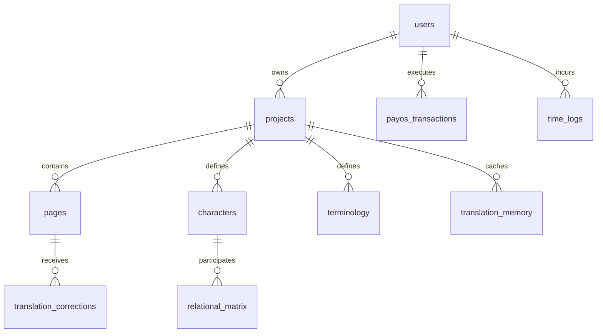
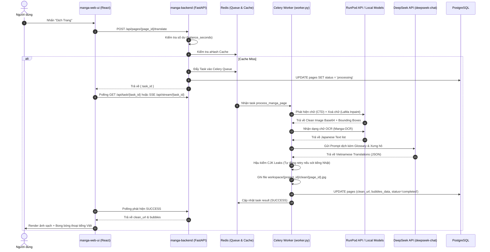
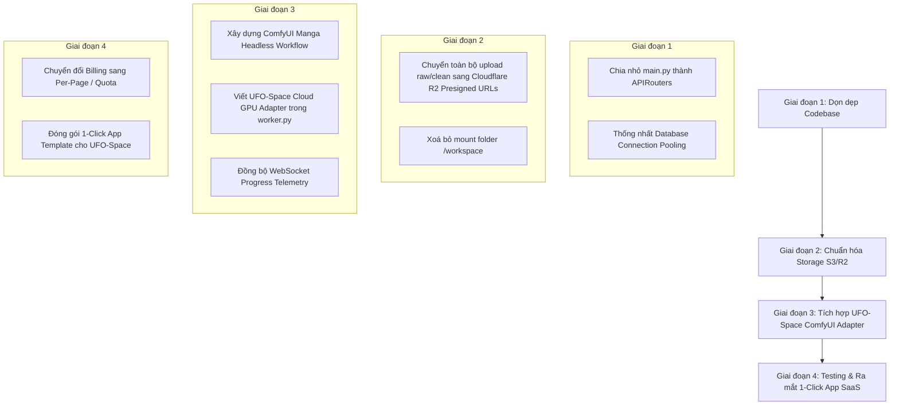

# BÁO CÁO KIẾN TRÚC HIỆN TRẠNG (AS-IS ARCHITECTURAL REPORT)
## DỰ ÁN HỆ THỐNG DỊCH TRUYỆN TRANH TỰ ĐỘNG BẰNG AI (AI MANGA TRANSLATOR)
**Chuẩn bị tích hợp 1-Click App SaaS trên Hạ tầng Cloud GPU (UFO-Space)**

---

- **Ngày lập báo cáo:** 06/09/2026
- **Kiến trúc sư trưởng (Principal Software Architect):** AI Architecture Reviewer
- **Mã nguồn thẩm định:** `AI_Manga_Translator` (`manga-backend` + `manga-web-ui`)
- **Mục tiêu chuyển đổi:** Tách rời tải trọng AI khỏi VPS/RunPod Serverless, chuyển đổi sang kiến trúc Headless ComfyUI chạy trên hạ tầng cụm GPU đám mây UFO-Space (`https://ufospace.cloud/`).

---

## 1. TỔNG QUAN TECH STACK (TECHNOLOGY STACK AS-IS)

Dự án hiện tại được tổ chức theo mô hình **Monorepo (Decoupled Client-Server)** gồm 2 thành phần chính kết nối với nhau qua REST API, WebSockets/SSE và Background Task Queues.

```
AI_Manga_Translator/
├── docker-compose.yml          # Điều phối Postgres, Redis, FastAPI, Celery, React UI
├── manga-web-ui/              # Single Page Application (React 19 + Vite)
│   ├── package.json
│   ├── src/
│   │   ├── components/Editor/ # Fabric.js + Konva Manga Canvas & Bubbles Engine
│   │   ├── services/api.ts    # HTTP Client & Polling Engine
│   │   └── store/             # Zustand Global State
└── manga-backend/             # RESTful API & AI Worker (FastAPI + Celery)
    ├── main.py                # Monolithic Gateway API (5,497 dòng)
    ├── worker.py              # Celery AI Worker điều phối OCR & Inpainting
    ├── db_models.py           # SQLAlchemy Data Models
    ├── nlp_engine.py          # LLM Translation Prompting Engine
    └── s3_utils.py            # Cloudflare R2 Storage Adapter
```

### 1.1. Frontend (manga-web-ui)
- **Core Framework:** React 19 (`react: 19.2.0`), TypeScript 5.9, Vite 8 (`@vitejs/plugin-react: 4.3.4`).
- **Styling:** Tailwind CSS v4 (`@tailwindcss/vite`, `@tailwindcss/typography`), Lucide React.
- **Canvas & Typography Rendering:** 
  - `fabric: ^7.1.0` & `konva: ^10.0.8` (`react-konva: ^19.2.0`): Xử lý hiển thị ảnh raw/clean, các layer thoại, bounding box và nét vẽ thủ công (brush mask) để tẩy xoá.
  - `ag-psd: ^28.0.0` & `psd-tools` (Backend): Tạo và giải mã file Photoshop (PSD) có phân tách từng layer text.
- **State Management:** Zustand 5 (`zustand: ^5.0.11`) với các store chuyên biệt: `useEditorStore`, `useAuthStore`, `useProjectStore`.
- **Authentication:** `@supabase/supabase-js: ^2.48.7` (Quản lý đăng ký, đăng nhập qua Google OAuth / Email và cấp JWT Token).
- **HTTP Client:** Fetch API tùy biến có tích hợp bộ chặn lỗi 401 tự động gia hạn phiên qua Supabase Client (`manga-web-ui/src/services/api.ts`).

### 1.2. Backend API (manga-backend)
- **Web Framework:** FastAPI 0.110 (`python 3.10+`), Uvicorn ASGI Server.
- **Task Queue & Async Scheduler:** Celery 5.3 (`celery[redis]`), Redis 7 (`redis.asyncio` & `redis-py`).
- **Cơ sở dữ liệu:** PostgreSQL 16 (Hỗ trợ extension `pgvector`), kết nối qua SQLAlchemy 2.0.
  - Tầng API sử dụng kết nối bất đồng bộ: `asyncpg` (`postgresql+asyncpg://`).
  - Tầng Celery Worker sử dụng kết nối đồng bộ: `psycopg2-binary` (`postgresql://`).
- **Billing & Thanh toán:** Tích hợp cổng PayOS (`payos: 1.1.2`) cho thị trường Việt Nam (chuyển khoản VietQR tự động cập nhật số dư thời gian tính bằng giây: 10,000 VND = 900s).

### 1.3. AI Engine & Pipelines hiện tại (Hybrid Architecture)
Hệ thống hiện tại đang sử dụng cơ chế lai giữa **Local Inference** và **RunPod Serverless**:
1. **Text Detection (Phát hiện chữ):** `comic-text-detector` (`comictextdetector.pt` / ONNX).
2. **Inpainting / Clean Mask (Tẩy chữ):** Mô hình LaMa ONNX (`lama-manga.onnx`) hoặc gửi sang endpoint RunPod Inpainting.
3. **OCR (Nhận dạng văn bản gốc):** `manga-ocr` (Offline ONNX/PyTorch cho tiếng Nhật) hoặc PaddleOCR.
4. **Machine Translation (Dịch thuật ngữ cảnh):** Gọi API đám mây DeepSeek (`deepseek-chat`) thông qua `openai` Python SDK với hệ thống Prompt kiểm tra xưng hô và thuật ngữ.

---

## 2. CẤU TRÚC DATABASE (DATA MODELS AS-IS)

Toàn bộ lược đồ cơ sở dữ liệu được định nghĩa tập trung trong `manga-backend/db_models.py`.



### 2.1. Các bảng dữ liệu cốt lõi

| Tên Bảng | Khóa chính | Mục đích & Ý nghĩa |
| :--- | :--- | :--- |
| `users` | `id` (String - Supabase UID) | Lưu trữ thông tin người dùng, số dư thời gian GPU (`balance_seconds`, mặc định tặng 900s), trạng thái Pro (`is_pro`, `pro_until`). |
| `projects` | `id` (String UUID) | Đại diện cho một bộ truyện / tập truyện (Manga Project). Thuộc sở hữu của `user_id`. |
| `pages` | `id` (String UUID) | Từng trang truyện đơn lẻ trong một `project`. Lưu trạng thái xử lý, đường dẫn ảnh gốc, ảnh sạch và dữ liệu bong bóng thoại. |
| `payos_transactions` | `order_code` (BigInteger) | Lưu lịch sử giao dịch nạp tiền qua cổng PayOS (VietQR), trạng thái nạp tiền và số giây GPU cộng thêm. |
| `time_logs` | `id` (UUID) | Ghi nhận nhật ký trừ giây sử dụng GPU chi tiết cho từng tác vụ (`task_type`, `seconds_deducted`). |
| `gpu_sessions` | `id` (UUID) | Quản lý phiên khởi động máy chủ GPU ảo (RunPod Pod instance). |

### 2.2. Chi tiết bảng `pages` (Bảng trung tâm luồng xử lý ảnh)
- `id` (VARCHAR, PK): Định danh duy nhất của trang truyện.
- `project_id` (VARCHAR, FK -> `projects.id` ON DELETE CASCADE): Dự án chứa trang truyện.
- `filename` (VARCHAR): Tên tệp tin gốc của ảnh tải lên (VD: `001.png`).
- `status` (VARCHAR): Trạng thái của trang (`unprocessed` / `pending` -> `processing` -> `completed` / `failed`).
- `raw_url` (VARCHAR): Đường dẫn phục vụ ảnh gốc (VD: `/workspace/{project_id}/raw/{page_id}.jpg`).
- `clean_url` (VARCHAR, Nullable): Đường dẫn phục vụ ảnh sau khi xóa chữ (VD: `/workspace/{project_id}/clean/{page_id}.jpg`).
- `bubbles_data` (TEXT - JSON String): Mảng JSON lưu trữ toàn bộ bong bóng thoại được trích xuất và dịch.

#### Cấu trúc JSON của trường `bubbles_data`:
```json
[
  {
    "id": 1,
    "box_coordinates": { "x1": 420, "y1": 150, "x2": 610, "y2": 380 },
    "japanese": "俺の名はうずまきナルトだってばよ！",
    "vietnamese": "Tên tôi là Uzumaki Naruto dattebayo!",
    "text": "Tên tôi là Uzumaki Naruto dattebayo!",
    "style": {
      "font_family": "AnimeAce",
      "font_size": 18,
      "color": "#000000",
      "direction": "horizontal",
      "alignment": "center"
    }
  }
]
```

### 2.3. Bảng hỗ trợ dịch thuật ngữ cảnh cao cấp
- `characters`: Quản lý danh sách nhân vật truyện (`original_name`, `translated_name`, `gender`, `age_group`).
- `relational_matrix`: Ma trận quan hệ xưng hô giữa các nhân vật (`speaker_id`, `listener_id`, `pronoun_speaker`, `pronoun_listener`).
- `terminology`: Bộ từ điển thuật ngữ / chiêu thức ưu tiên cho truyện tranh (`source_text`, `target_text`).
- `translation_memory`: Bộ nhớ dịch thuật (Exact Match Cache) lưu mã băm SHA-256 câu thoại gốc để dịch tức thì không tốn token LLM.

---

## 3. LUỒNG DỮ LIỆU UPLOAD & HIỂN THỊ ẢNH (AS-IS IMAGE DATA FLOW)

### 3.1. Luồng tải lên ảnh gốc (Upload Flow)
```
[User Browser]
       │ 1. Chọn file ảnh (PNG/JPG)
       ▼
[manga-web-ui: api.ts -> uploadProjectFile]
       │ 2. POST /api/projects/{project_id}/upload (Multipart/form-data)
       ▼
[manga-backend: main.py -> upload_pages (Line 832)]
       │ 3. Xác thực JWT Supabase (check_project_ownership)
       │ 4. Lưu trực tiếp vào ổ cứng cục bộ VPS:
       │    workspace/{project_id}/raw/{page_id}.{ext}
       │ 5. Insert vào bảng `pages` (status = "unprocessed", raw_url = "/workspace/...")
       ▼
[PostgreSQL Database]
```

- **File code xử lý Frontend:** [api.ts](file:///d:/Workspaces/VSCode-workspace/AI_Manga_Translator/manga-web-ui/src/services/api.ts) (`uploadProjectFile`) và [MangaProcessor.tsx](file:///d:/Workspaces/VSCode-workspace/AI_Manga_Translator/manga-web-ui/src/components/MangaProcessor.tsx).
- **File code xử lý Backend:** [main.py](file:///d:/Workspaces/VSCode-workspace/AI_Manga_Translator/manga-backend/main.py#L832-L950) (`@app.post("/api/projects/{project_id}/upload")`).
- **Điểm lưu trữ:** Ổ đĩa cứng cục bộ của VPS/Docker container tại thư mục `manga-backend/workspace/{project_id}/raw/`.

### 3.2. Cơ chế phân phối & hiển thị ảnh (Static Serving)
- **Middleware CORS:** [main.py](file:///d:/Workspaces/VSCode-workspace/AI_Manga_Translator/manga-backend/main.py#L51-L60) (`force_cors_static_files`) chèn tiêu đề CORS (`Access-Control-Allow-Origin: *`) cho mọi request bắt đầu bằng `/workspace`.
- **Endpoint phục vụ tĩnh:** [main.py](file:///d:/Workspaces/VSCode-workspace/AI_Manga_Translator/manga-backend/main.py#L546) (`@app.get("/workspace/{file_path:path}")`) đọc file từ ổ đĩa và trả về qua `FileResponse`.
- **Render Canvas:** [MangaCanvas.tsx](file:///d:/Workspaces/VSCode-workspace/AI_Manga_Translator/manga-web-ui/src/components/Editor/MangaCanvas.tsx) khởi tạo HTML5 Canvas qua Fabric.js / Konva:
  1. Vẽ ảnh nền (`raw_url` nếu chưa dịch hoặc `clean_url` sau khi đã xóa chữ).
  2. Lặp qua mảng `bubbles_data` để dựng các node bong bóng thoại ([BubbleNode.tsx](file:///d:/Workspaces/VSCode-workspace/AI_Manga_Translator/manga-web-ui/src/components/Editor/BubbleNode.tsx)), cho phép kéo thả, xoay và chỉnh sửa chữ trực tiếp.

---

## 4. LUỒNG DỊCH THUẬT & XỬ LÝ AI HIỆN TẠI (CURRENT PIPELINE)

### 4.1. Sơ đồ xử lý tuần tự (Execution Pipeline)



### 4.2. Các bước xử lý chi tiết trong `worker.py`
1. **Kiểm tra Checkpoint Huỷ:** [worker.py](file:///d:/Workspaces/VSCode-workspace/AI_Manga_Translator/manga-backend/worker.py#L548-L552) (`is_task_cancelled(task_id)`) nhằm ngắt ngay lập tức nếu người dùng bấm Hủy trên giao diện, tiết kiệm chi phí tính toán.
2. **Text Detection & Inpainting:**
   - Nếu chạy Local (`RUN_LOCAL_AI=true`): Dùng `comic_text_detector` trích xuất `ctd_mask` -> giãn nở (dilate) tạo `lama_mask` -> đưa qua mô hình ONNX `lama-manga.onnx` để tạo ảnh nền sạch không còn chữ.
   - Nếu chạy Cloud (mặc định): Gửi request POST sang RunPod Serverless Endpoint (`https://api.runpod.ai/v2/{RUNPOD_ENDPOINT_ID}/run`) với payload ảnh Base64.
3. **Manga OCR:** Đọc từng tọa độ bounding box và chuyển đổi ảnh con thành chữ tiếng Nhật thô (Raw OCR text).
4. **DeepSeek LLM Translation:**
   - Hệ thống Prompt: Yêu cầu đóng vai dịch giả truyện tranh chuyên nghiệp, trả về JSON chuẩn `{"translations": [{"id": 1, "translation": "..."}]}`.
   - Inject ngữ cảnh: Ghép nối `genre`, `tone`, bảng xưng hô `pronouns`, và từ điển `glossary`.
   - Cơ chế tự chữa lành (Self-Healing Fallback): Nếu bản dịch trả về còn chứa ký tự CJK (chữ Hán, Hiragana, Katakana), hàm `contains_cjk_characters()` sẽ phát hiện và tự động kích hoạt lần gọi thứ hai với cảnh báo nghiêm ngặt để ép DeepSeek dịch 100% sang tiếng Việt.

---

## 5. PHÂN TÍCH ĐIỂM NỐI (INTEGRATION POINTS) SANG HẠ TẦNG CLOUD GPU (UFO-SPACE)

Để chuyển đổi dự án này thành **1-Click App SaaS trên hệ thống UFO-Space Cloud GPU**, chúng ta sẽ thay thế toàn bộ tải trọng tính toán của RunPod Serverless / Local ONNX bằng **Headless ComfyUI Workflow** được kích hoạt tự động qua API trên máy chủ GPU UFO-Space (`https://ufospace.cloud/` hoặc instance private tunnel).

### 5.1. Bảng phân tích chi tiết các tệp và hàm cần chỉnh sửa

| STT | File cần can thiệp | Hàm / Đoạn code cụ thể | Nhiệm vụ & Phương án tái cấu trúc cho UFO-Space |
| :---: | :--- | :--- | :--- |
| **1** | [worker.py](file:///d:/Workspaces/VSCode-workspace/AI_Manga_Translator/manga-backend/worker.py#L533-L740) | `process_manga_page` | **Thay thế toàn bộ nhánh RunPod API:**<br>Loại bỏ `api.runpod.ai/v2/...`, tạo Adapter gọi REST API đến ComfyUI trên UFO-Space: `POST /prompt` với workflow JSON headless (chứa nodes: `ComicTextDetector` -> `LaMaInpaint` -> `MangaOCR`). Worker sẽ subscribe WebSocket `/ws?clientId=...` của ComfyUI để nhận tiến độ tính toán theo thời gian thực (0% -> 100%). |
| **2** | [main.py](file:///d:/Workspaces/VSCode-workspace/AI_Manga_Translator/manga-backend/main.py#L3148-L3270) | `@app.post("/api/pages/{page_id}/translate")` | **Định tuyến lại Endpoint Dịch:**<br>Thêm tham số lựa chọn hạ tầng (`gpu_provider="ufo-space"`). Đồng bộ trạng thái GPU từ UFO-Space Watchdog/Agent để biết máy chủ GPU đã sẵn sàng (HOT/BOOTED) trước khi đưa task vào hàng đợi. |
| **3** | [main.py](file:///d:/Workspaces/VSCode-workspace/AI_Manga_Translator/manga-backend/main.py#L2100-L2450) | `@app.post("/api/redraw")`<br>`@app.post("/api/erase-mask")`<br>`@app.post("/api/ctd-erase")` | **Chuyển đổi Inpainting Tương tác sang UFO-Space:**<br>Hiện tại các API này gọi RunPod Redraw Endpoint (`RUNPOD_REDRAW_ENDPOINT_ID`). Cần chuyển sang kích hoạt node `InpaintModelConditioning` + `KSampler` trực tiếp trên ComfyUI UFO-Space với độ trễ cực thấp. |
| **4** | [s3_utils.py](file:///d:/Workspaces/VSCode-workspace/AI_Manga_Translator/manga-backend/s3_utils.py) & [main.py](file:///d:/Workspaces/VSCode-workspace/AI_Manga_Translator/manga-backend/main.py#L40) | `upload_to_r2`, `get_presigned_put_url` | **Chuyển đổi Storage sang Cloudflare R2 / S3 Presigned URL:**<br>Loại bỏ việc ghi ảnh vào thư mục local `workspace/`. Khi user tải ảnh lên hoặc ComfyUI sinh ra ảnh sạch, ảnh sẽ được đẩy trực tiếp lên Cloud Storage (R2) và ComfyUI chỉ việc nhận S3 Presigned URL để đọc/ghi, giải phóng hoàn toàn gánh nặng ổ cứng cho máy chủ backend. |
| **5** | [manga-web-ui/src/services/api.ts](file:///d:/Workspaces/VSCode-workspace/AI_Manga_Translator/manga-web-ui/src/services/api.ts#L119-L166) | `translatePage`, `eraseMask`, `redrawMask` | **Tối ưu hóa cơ chế Polling / Streaming trên Web UI:**<br>Thay vì polling mù mờ 1s/lần qua `/api/task/{taskId}`, kết nối trực tiếp với Server-Sent Events (`/api/stream/{taskId}`) để nhận chi tiết trạng thái từ UFO-Space (VD: "Đang boot GPU Vast.ai/Runpod" -> "Đang chạy ComfyUI Text Detector" -> "Đang xóa chữ"). |

### 5.2. Kiến trúc Workflow Headless ComfyUI đề xuất trên UFO-Space

Hệ thống UFO-Space sẽ đóng gói sẵn một ComfyUI Headless Docker Image với custom nodes tối ưu:
1. **LoadImageFromURL Node:** Nhận presigned URL ảnh gốc từ Cloudflare R2.
2. **ComicTextDetector Node:** Trả ra danh sách coordinates (JSON) và mask nhị phân của chữ.
3. **LaMa Inpainting Node:** Dùng model `lama-manga` loại bỏ toàn bộ chữ, giữ lại đường nét tranh.
4. **MangaOCR Node:** Đọc chữ trong từng bounding box.
5. **SaveImageToS3 Node:** Đẩy trực tiếp ảnh `clean` về R2 và trả về Webhook cho FastAPI Backend.

---

## 6. NỢ KỸ THUẬT (TECH DEBT) & RÀO CẢN CẦN GIẢI QUYẾT TRƯỚC KHI LÊN SAAS

Qua quá trình rà soát chi tiết toàn bộ codebase, kiến trúc hiện tại tồn tại **5 nợ kỹ thuật nghiêm trọng** cần phải được xử lý triệt để trước khi thương mại hóa thành SaaS:

### 6.1. File `main.py` là một Monolith khổng lồ (5,497 dòng code)
- **Vấn đề:** Toàn bộ logic định tuyến (Router), xác thực (Auth), thanh toán PayOS, xử lý ảnh OpenCV, upload tệp, quản lý GPU session, và thậm chí cả logic nghiệp vụ đều bị nhồi nhét vào một file duy nhất `manga-backend/main.py`.
- **Rủi ro:** Cực kỳ khó bảo trì, dễ xảy ra lỗi xung đột git khi nhiều lập trình viên cùng làm việc, không thể viết unit test độc lập.
- **Giải pháp:** Tách nhỏ thành kiến trúc module chuẩn FastAPI sử dụng `APIRouter`:
  - `routers/projects.py`, `routers/pages.py`, `routers/translation.py`, `routers/payments.py`, `routers/gpu_proxy.py`.

### 6.2. Phụ thuộc chặt chẽ vào ổ cứng cục bộ (`workspace/` Filesystem Coupling)
- **Vấn đề:** Cả `main.py` và `worker.py` đều đọc/ghi file trực tiếp qua đường dẫn cục bộ `workspace/{project_id}/raw/...` và `workspace/{project_id}/clean/...`.
- **Rào cản SaaS:** Khi triển khai trên môi trường Cloud phân tán (Backend chạy trên VPS, Worker chạy trên máy chủ khác, GPU chạy trên UFO-Space), các máy chủ không dùng chung ổ cứng sẽ dẫn đến lỗi `FileNotFoundError` (như đã thấy kiểm tra ở dòng 3164 `main.py`).
- **Giải pháp:** Chuyển đổi 100% việc lưu trữ sang Object Storage (Cloudflare R2 hoặc AWS S3) bằng **S3 Presigned URLs**. Client upload thẳng lên S3; GPU ComfyUI kéo ảnh từ S3 và đẩy trả lại S3.

### 6.3. Bất đồng nhất tầng Database (Async/Sync Connection Leak)
- **Vấn đề:** 
  - `main.py` dùng SQLAlchemy Async Engine (`asyncpg`) với `get_db()`.
  - `worker.py` lại khởi tạo kết nối đồng bộ `SessionLocal()` (`psycopg2`) mà không có cơ chế quản lý vòng đời connection pool chặt chẽ.
- **Rủi ro:** Khi có hàng chục tác vụ dịch chạy song song, cơ sở dữ liệu PostgreSQL sẽ bị cạn kiệt Connection Pool (`Too many connections`), làm sập toàn bộ hệ thống API.

### 6.4. Cơ chế Tính cước và Trừ tiền (Billing Logic) chưa an toàn
- **Vấn đề:** Trừ tiền dựa trên `balance_seconds` được tính toán bằng cách đo thời gian thực thi `time.perf_counter()` giữa các chặng. Nếu mạng chập chờn hoặc GPU cold-boot khởi động chậm, người dùng sẽ bị trừ oan rất nhiều tiền cho thời gian chờ vô ích.
- **Giải pháp SaaS:** Chuyển sang tính phí theo **Đơn vị Tác vụ (Per-Page / Per-Image Pricing)** hoặc chỉ tính giờ GPU cho thời gian thực sự render của ComfyUI (Execution Time trả về từ metadata của ComfyUI History API).

### 6.5. Thiếu Queue Backpressure & Circuit Breaker cho cụm GPU
- **Vấn đề:** Nếu 50 người dùng cùng nhấn dịch một lúc, hệ thống sẽ đẩy 50 task vào Celery. Celery sẽ bắn ồ ạt 50 request sang cụm GPU, gây nghẽn VRAM và Crash Out-Of-Memory (OOM) trên máy chủ GPU.
- **Giải pháp:** Tích hợp Semaphore / Concurrency Limiter trong Celery và Redis để điều tiết lưu lượng dựa trên số lượng GPU worker thực tế đang online trên UFO-Space.

---

## 7. LỘ TRÌNH TRIỂN KHAI ĐỀ XUẤT (RECOMMENDED IMPLEMENTATION ROADMAP)



---
*Báo cáo được lập tự động bởi Antigravity Software Architecture Engine.*
