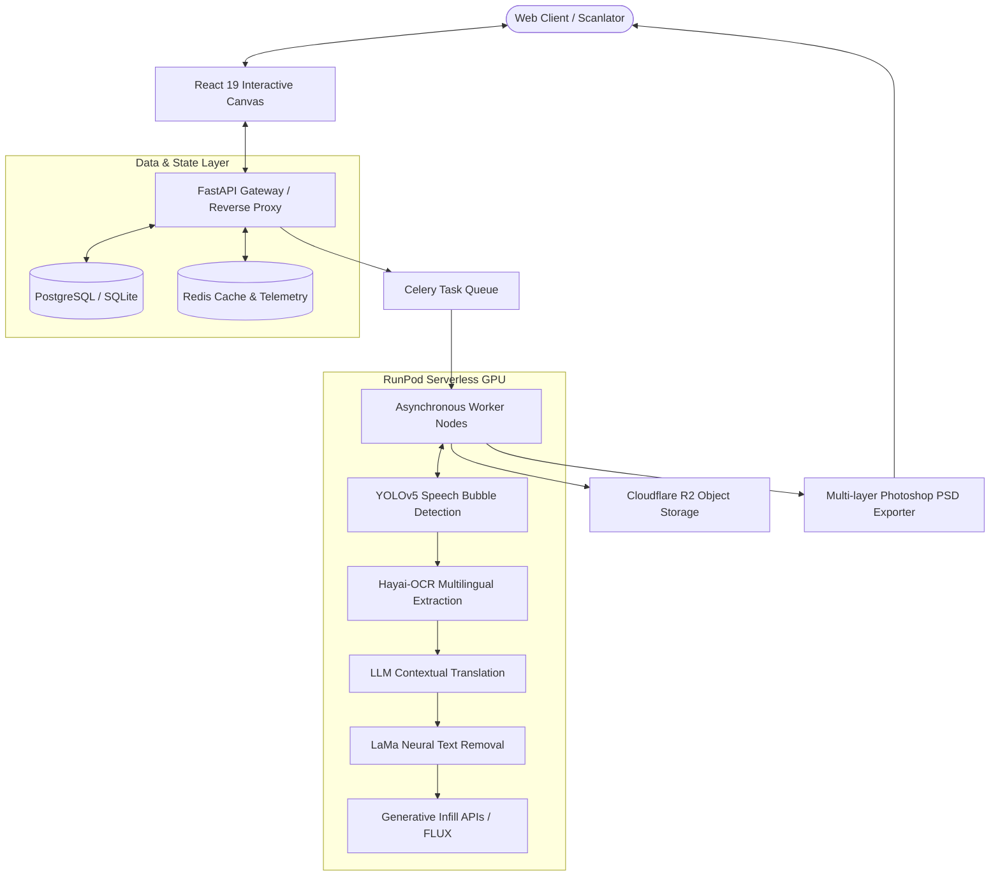

<div align="center">

# 📖 DeepKoma — AI Manga Translator
### *Next-Generation Multimodal Comic Localization & Studio Redraw Engine*

[](https://python.org)
[](https://fastapi.tiangolo.com)
[](https://react.dev)
[](https://typescriptlang.org)
[](https://docs.celeryq.dev)
[](https://docker.com)
[](LICENSE)

<br/>

<p align="center">
  
</p>

*An end-to-end production platform for automated comic localization: from deep-learning text segmentation to context-aware translation and multi-layer Photoshop (.PSD) export.*

[🌐 Live Platform](https://manga.ufospace.cloud) • [📑 Architecture Docs](ComicApp_Architecture_Report.md) • [🚀 Quickstart](#-quickstart)

---

</div>

## 🌟 Key Highlights

- **🎯 Comic Text Detector (CTD / YOLOv5)**: High-precision neural detector tailored for vertical text, irregular speech bubbles, and embedded sound effects (SFX).
- **🔍 Multilingual OCR Engine (Hayai-OCR)**: Zero-redundancy character extraction pipeline supporting Japanese (Kanji/Kana), Korean (Hangul), Chinese (Hanzi), and English.
- **🎨 Deep Inpainting (LaMa)**: Intelligent text erasure that restores complex background screentones, lineart, and color gradients without artifacts.
- **🌐 Context-Aware Translation**: Dynamic prompt routing across modern LLMs to capture dialect, character tone, and comic nuances accurately.
- **🖌️ Interactive Canvas Studio (React 19)**: In-browser editor enabling real-time bubble repositioning, typography styling, and custom font mapping.
- **💾 Layered Photoshop (.PSD) Export**: Generates production-ready, editable PSD files with separated text layers, saving scanlation teams over 80% manual typesetting time.
- **⚡ Cost-Optimized Cloud GPU Orchestration**: Deployed on RunPod serverless GPU pods with Network Storage (Network Volume) mounting, eliminating cold-start latency while reducing cloud compute overhead by ~75% compared to dedicated VMs.

---

## 🏛️ System Architecture



---

## 📂 Project Structure

```bash
AI_Manga_Translator/
├── manga-web-ui/               # Frontend Studio (React 19, TypeScript, Tailwind, Vite)
│   ├── src/components/Editor/  # Interactive canvas & bubble node controllers
│   ├── src/store/              # Zustand global state (Canvas, Project, Auth)
│   └── src/utils/typography.ts # Font measurement & text formatting logic
│
├── manga-backend/              # Core API & Worker Services (Python, FastAPI)
│   ├── comic_text_detector/    # Custom YOLOv5 text & bubble detection models
│   ├── ocr_router.py           # Unified Multilingual OCR router (Hayai-OCR)
│   ├── task_manager.py         # Asynchronous task dispatch & progress tracking
│   ├── psd_utils.py            # High-performance multi-layer PSD generator
│   └── runpod_service.py       # Serverless GPU compute dispatcher
│
├── infra/                      # Infrastructure & Deployment manifests
│   ├── docker-compose.yml      # Multi-container local/production orchestration
│   └── deepkoma.nginx.conf     # Nginx reverse proxy & rate-limiting configs
│
└── deepkoma.env.example        # Environment variables template
```

---

## 🚀 Quickstart

### 1. Prerequisites
- [Docker](https://www.docker.com/) & Docker Compose
- [Python 3.10+](https://www.python.org/)
- [Node.js 18+](https://nodejs.org/) & `npm`

### 2. Configuration
Copy the sample environment file and configure your credentials:
```bash
cp deepkoma.env.example deepkoma.env
```

### 3. Running with Docker Compose (Recommended)
Launch the entire stack (FastAPI Backend, Celery Worker, Redis, and React Web UI):
```bash
docker-compose up -d --build
```
Access the application:
- **Web Studio UI**: `http://localhost:5173` (or `http://localhost:80`)
- **Interactive API Docs**: `http://localhost:8000/docs`

### 4. Local Development Setup

#### Backend:
```bash
cd manga-backend
python -m venv venv
# Windows:
venv\Scripts\activate
# Linux/macOS:
source venv/bin/activate

pip install -r requirements.txt
uvicorn main:app --reload --port 8000
```

#### Frontend:
```bash
cd manga-web-ui
npm install
npm run dev
```

---

## ⚙️ Environment Variables Reference

| Variable | Description | Default / Example |
| :--- | :--- | :--- |
| `BACKEND_BASE_URL` | Public endpoint for the backend API | `http://localhost:8000` |
| `RUNPOD_API_KEY` | RunPod API token for serverless execution | `your_runpod_api_key` |
| `RUNPOD_TRANSLATE_ENDPOINT_ID` | RunPod endpoint ID for OCR/Inpaint workers | `your_endpoint_id` |
| `R2_ACCOUNT_ID` | Cloudflare R2 Account ID for media storage | `your_r2_account_id` |
| `R2_BUCKET_NAME` | S3-compatible R2 storage bucket name | `manga-temp-storage` |
| `PAYOS_CLIENT_ID` | PayOS client ID for payment integration | `your_payos_client_id` |

---

## 🧪 Testing

Run local automated test suites verifying end-to-end processing pipelines:
```bash
# Run unit & integration tests
python manga-backend/tests/test_worker_pipeline.py
python manga-backend/tests/test_ocr_languages.py
python manga-backend/tests/test_security_and_finances.py
```

---

## 📄 License

This project is released under the [MIT License](LICENSE). Contributions, bug reports, and suggestions are welcome!

<div align="center">
  <sub>Engineered with ❤️ by <b>DAO DANG THUAN</b> • Solo Full-Stack Project</sub>
</div>
